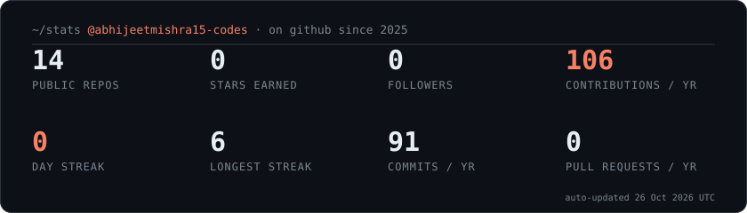
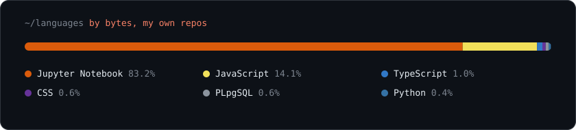

<div align="center">



<br>

[](https://www.linkedin.com/in/abhijeet-mishra-45b0b4231)
[](mailto:abhijeetmishra9117@gmail.com)


</div>

<br>

## What I'm up to

I'm a computer science student in India. Most of what I know came from picking a project slightly beyond my reach and getting it working: a collaborative editor, a couple of hackathon builds, and a handful of ML classifiers I trained to understand how models actually fail.

Right now I'm moving from classical ML toward deep learning, and trying to build a RAG app that does something useful instead of another PDF chatbot. I also grind DSA, because contests keep me honest.

```text
building   ->  full-stack apps, hackathon projects
learning   ->  deep learning, LLM apps, retrieval
practising ->  DSA and competitive programming
open to    ->  open-source collaboration, study groups
```

<br>

## Things I've built

<table>
  <tr>
    <td width="50%" valign="top">
      <a href="https://github.com/abhijeetmishra15-codes/realtime-code-editor"><b>realtime-code-editor</b></a><br>
      <sub>Rooms where several people write and run code together live. C++, Java, Python and JavaScript.</sub><br><br>
      <code>React</code> <code>Node.js</code> <code>Socket.io</code>
    </td>
    <td width="50%" valign="top">
      <a href="https://github.com/abhijeetmishra15-codes/PCON_Hackathon"><b>Alumni Connect</b></a><br>
      <sub>Built at PCON Hackathon to bring alumni and current students into the same room.</sub><br><br>
      <code>React</code> <code>Node.js</code> <code>MongoDB</code>
    </td>
  </tr>
  <tr>
    <td width="50%" valign="top">
      <a href="https://github.com/abhijeetmishra15-codes/Vibe2Ship_Hackathon"><b>Vibe2Ship</b></a><br>
      <sub>Hackathon build, shipped inside the event window.</sub><br><br>
      <code>JavaScript</code>
    </td>
    <td width="50%" valign="top">
      <a href="https://github.com/abhijeetmishra15-codes/Email_spam_Classifier"><b>Email spam classifier</b></a><br>
      <sub>My first ML project, straight after learning Naive Bayes.</sub><br><br>
      <code>Python</code> <code>scikit-learn</code> <code>Pandas</code>
    </td>
  </tr>
  <tr>
    <td width="50%" valign="top">
      <a href="https://github.com/abhijeetmishra15-codes/Rock_vs_Mine_Classifier_for_submarines"><b>Rock vs Mine</b></a><br>
      <sub>Classifying sonar returns as rock or mine.</sub><br><br>
      <code>Python</code> <code>scikit-learn</code> <code>NumPy</code>
    </td>
    <td width="50%" valign="top">
      <a href="https://github.com/abhijeetmishra15-codes/Employee_salary_classification"><b>Employee salary classification</b></a><br>
      <sub>Predicting salary bracket from employee attributes.</sub><br><br>
      <code>Python</code> <code>scikit-learn</code> <code>Pandas</code>
    </td>
  </tr>
</table>

<br>

## By the numbers

Refreshed automatically every six hours by a GitHub Action.

<div align="center">


<br><br>


</div>

<br>

## Latest commits

<!--RECENT:START-->
_Quiet week. Back soon._
<!--RECENT:END-->

<br>

## Toolbox

<p>
  
</p>
<sub>Plus NumPy, Pandas and scikit-learn for ML, and JWT-based auth when a project needs logins.</sub>

<br>

## Contribution graph

<div align="center">
  <picture>
    <source media="(prefers-color-scheme: dark)" srcset="https://raw.githubusercontent.com/abhijeetmishra15-codes/abhijeetmishra15-codes/output/snake-dark.svg">
    
  </picture>
</div>

<br>

<div align="center">
  <sub>"First, solve the problem. Then, write the code." — John Johnson</sub>
</div>
